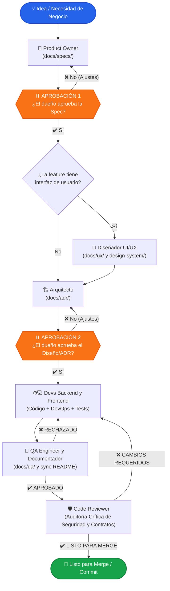

# 🚀 equipo-dev

[](CHANGELOG.es.md)
[](LICENSE)
[](https://nodejs.org/)
[](docs/adr/001-reestructuracion-multi-ai.md)
[](tests/)
[](https://github.com/GeboArt-Dev/Equipo-Dev/pulls)

**Un equipo autónomo de desarrollo de software multi-rol con subagentes de IA para tu entorno de desarrollo.**  
Transforma ideas en código listo para producción, probado y revisado por pares, con aprobaciones humanas estructuradas y cero divergencia técnica.

---

### 🌐 Idioma / Language
[English](README.md) | **Español** | [Historial de Cambios](CHANGELOG.es.md)

---

## 📖 Tabla de Contenidos

- [Resumen](#-resumen)
- [El Equipo y sus Roles](#-el-equipo-y-sus-roles)
- [Cómo Funciona (Flujo de Trabajo)](#-cómo-funciona-flujo-de-trabajo)
- [Aprobaciones Humanas Obligatorias](#-aprobaciones-humanas-obligatorias)
- [Modos de Ejecución y Salvaguardas](#-modos-de-ejecución-y-salvaguardas)
- [Guía de Instalación por SO y Plataforma](#-guía-de-instalación-por-so-y-plataforma)
  - [Google Antigravity](#1-google-antigravity)
  - [Claude Code](#2-claude-code)
  - [Cursor](#3-cursor)
  - [GitHub Copilot](#4-github-copilot)
  - [Codex](#5-codex)
- [Uso e Inicio Rápido](#-uso-e-inicio-rápido)
- [Requisitos de Configuración del Proyecto](#-requisitos-de-configuración-del-proyecto)
- [Arquitectura Multi-AI (`src/` + `platforms/`)](#-arquitectura-multi-ai-src--platforms)
- [Compilador CLI y Empaquetado](#-compilador-cli-y-empaquetado)
- [Pruebas Automatizadas](#-pruebas-automatizadas)
- [Nuevas Capacidades y Referencia Técnica](#-nuevas-capacidades-y-cambios-skill-fix-resolucion-problemas)
- [Historial de Cambios (Changelog)](CHANGELOG.es.md)
- [Cómo Contribuir](#-cómo-contribuir)
- [Licencia](#-licencia)

---

## 🌟 Resumen

`equipo-dev` transforma tu asistente de código con IA (Google Antigravity, Claude Code, Cursor o GitHub Copilot) en un **departamento completo de ingeniería de software**. En lugar de emitir un prompt aislado que genera código directo sin arquitectura ni pruebas, `equipo-dev` orquesta subagentes especializados siguiendo un ciclo de vida ágil y disciplinado:

1. **Requisitos e Historias de Usuario** (Product Owner)
2. **Diseño UI/UX y Sistema de Diseño** (UI/UX Designer, si la feature tiene interfaz)
3. **Decisiones de Arquitectura y Contratos de Datos** (Software Architect)
4. **Implementación, DevOps y Pruebas Unitarias** (Backend y Frontend Developers)
5. **Aseguramiento de Calidad, Suites Mínimas y Documentación Continua** (QA Engineer)
6. **Auditoría de Seguridad y Revisión Crítica de Código** (Code Reviewer)

> [!IMPORTANT]
> **Tú eres el dueño y la autoridad final del proyecto.** El equipo se detiene obligatoriamente en dos puntos clave para solicitar tu aprobación explícita:
> 1. Tras la especificación del Product Owner (`docs/specs/`).
> 2. Tras el diseño técnico y contratos del Arquitecto (`docs/adr/`).

---

## 👥 El Equipo y sus Roles

| Avatar | Rol | Identificador | Responsabilidades Principales | Salidas Clave | Nivel de Modelo |
|:---:|---|---|---|---|:---:|
| 🎯 | **Product Owner** | `product-owner` | Diagnóstico del problema en la primera oración, calibración epistémica (`[Seguro]`, `[Probable]`, `[Especulando]`), historias de usuario con criterios Gherkin y prioridad MoSCoW. | `docs/specs/<feature>.md` | `pro` (Opus / Pro) |
| 🎨 | **Diseñador UI/UX** | `ux-designer` | Diseño mobile-first (< 640px base), vinculación estricta a tokens de diseño, checklist WCAG 2.1 AA (contraste ≥ 4.5:1, táctil ≥ 44px) y síntesis de decisiones para README. | `docs/ux/<feature>.md`<br>`design-system/` | `pro` (Opus / Pro) |
| 🏗️ | **Arquitecto de Software** | `architect` | Diagnóstico técnico en primera frase, calibración epistémica, contratos de API/datos, mitigaciones de seguridad y asignación ordenada de tareas (DevOps, UI, QA/Doc). | `docs/adr/<NNN>-<feature>.md` | `pro` (Opus / Pro) |
| ⚙️ | **Desarrollador Backend** | `backend-dev` | Código backend completo ejecutable, queries optimizadas (sin N+1), DevOps integrado (Dockerfiles multi-stage y CI/CD en YAML), cero secretos en claro, comentarios ≤ 1 línea. | Código fuente + Tests unitarios + Docker/CI-CD | `balanced` (Sonnet / Inherit) |
| 💻 | **Desarrollador Frontend** | `frontend-dev` | Maquetación mobile-first (< 640px base), WCAG 2.1 AA estricto, cobertura de los 5 estados de UI y registro de decisiones de diseño en README (≤ 2 oraciones). | Código UI + Tests de componentes | `balanced` (Sonnet / Inherit) |
| 🧪 | **Ingeniero QA** | `qa-engineer` | Suites mínimas esenciales (1 caso feliz + bordes críticos por criterio Gherkin), rol de Documentador integrado (actualización continua de README y referencia técnica) y veredicto binario. | `docs/qa/<feature>.md` + Actualización README | `balanced` (Sonnet / Inherit) |
| 🛡️ | **Revisor de Código** | `code-reviewer` | Auditoría exclusiva de hallazgos bloqueantes (seguridad OWASP, contratos de ADR, funcionalidad rota; cero observaciones de estilo), formato de 1 línea y veredicto binario. | Informe de Revisión (Solo Bloqueantes) | `pro` (Opus / Pro) |

---

## 🔄 Cómo Funciona (Flujo de Trabajo)



---

## ⏸️ Aprobaciones Humanas Obligatorias

El flujo de trabajo establece dos compuertas de diseño estructuradas en las que el equipo se detiene por completo esperando tu decisión en modo supervisado:

1. **Aprobación de la Spec (`⏸ spec`)**:
   - El Product Owner produce `docs/specs/<feature>.md`.
   - Evalúas el alcance, criterios y prioridades antes de que se tome cualquier decisión técnica o de diseño.
2. **Aprobación del Diseño (`⏸ diseño`)**:
   - El Arquitecto entrega `docs/adr/<NNN>-<feature>.md` (y el diseñador entrega `docs/ux/<feature>.md` si aplica).
   - Revisas la estrategia técnica, contratos de API, base de datos y diseño visual antes de que se escriba una sola línea de código de producción.

---

## 🎛️ Modos de Ejecución y Salvaguardas

`equipo-dev` ofrece dos modos de ejecución para balancear gobernanza y velocidad operativa:

### 1. Modo Supervisado / Interactivo (Por Defecto)
- **Invocación**: `/feature <descripción>` o `/feature continuemos con <nombre>`.
- **Comportamiento**: Se detiene de forma determinista en la Compuerta 1 (aprobación de Spec) y Compuerta 2 (aprobación de UX + ADR).
- **Indicado para**: Features complejas, lógica crítica de negocio o cuando se requiera validación humana cercana.

### 2. Modo Continuo / Autónomo (`--no-pause` / `--auto-approve`)
- **Invocación**: `/feature --no-pause <descripción>` o `/feature --auto-approve <descripción>`.
- **Comportamiento**: Omite las compuertas de diseño humano (Spec y UX/ADR). Transiciona fluidamente desde Product Owner directo a UX/Arquitecto y posteriormente a los Desarrolladores.
- **Regla de Ambigüedades**: Ante dudas técnicas no bloqueantes, adopta supuestos razonables más sencillos y los documenta en la spec/ADR. Si surge una duda bloqueante de negocio, se detiene y solicita aclaración humana.
- **Indicado para**: Prototipado rápido, ejecuciones desatendidas o pipelines automatizados.

> [!CAUTION]
> ### 🛡️ Salvaguardas Críticas Inviolables (En Ambos Modos)
> El modo continuo **nunca** relaja las compuertas de seguridad crítica. Las siguientes acciones **pausan estrictamente requiriendo autorización explícita**:
> 1. **Git Commits y Pushes**: Nunca realiza commit ni push sin autorización expresa del dueño.
> 2. **Comandos Destructivos**: Borrado masivo, eliminación de tablas o alteración irreversible de datos e infraestructura.
> 3. **Fallos Reiterados en QA/Revisión**: Ante el 3er rechazo consecutivo de QA o hallazgos bloqueantes del revisor, detiene la ejecución inmediatamente y transfiere el control al dueño.

---

## 💻 Guía de Instalación por SO y Plataforma

### Requisitos Previos
- **Node.js**: `v18.0.0` o superior (LTS recomendado). Verifica con:
  ```bash
  node -v
  ```
- **Git**: Instalado y configurado en el `PATH`. Verifica con:
  ```bash
  git --version
  ```
- **Python 3** *(Opcional)*: Solo requerido si se utiliza el subagente `ux-designer` con `ui-ux-pro-max`.

---

### Clonar el Repositorio

Clona `equipo-dev` en tu máquina local:

```bash
git clone https://github.com/GeboArt-Dev/Equipo-Dev.git
cd Equipo-Dev
```

---

### 1. Google Antigravity

Antigravity utiliza una estructura nativa de plugins con subagentes declarados en YAML, overrides de skills y registro de bitácora (`bitacora.mjs`).

#### Opción A: Compilación e Instalación Automática (Recomendada)

Ejecuta el compilador central con el parámetro `--install`:

```bash
node scripts/build.mjs --target antigravity --install
```

El instalador detecta el sistema operativo, genera los artefactos en `dist/antigravity/equipo-dev`, sincroniza los archivos en la ruta de plugins de Antigravity y preserva de manera segura el directorio `state/` (con tu bitácora histórica).

#### Opción B: Instalación Manual

Si prefieres compilar y copiar manualmente:

```bash
node scripts/build.mjs --target antigravity
```

Luego copia la carpeta `dist/antigravity/equipo-dev` al directorio correspondiente de tu sistema operativo:

| Sistema Operativo | Ruta Destino de Instalación | Comando PowerShell / Bash |
|---|---|---|
| **Windows** | `%USERPROFILE%\.gemini\config\plugins\equipo-dev` | `Copy-Item -Recurse -Force dist\antigravity\equipo-dev "$HOME\.gemini\config\plugins\"` |
| **macOS** | `~/.gemini/config/plugins/equipo-dev` | `mkdir -p ~/.gemini/config/plugins && cp -r dist/antigravity/equipo-dev ~/.gemini/config/plugins/` |
| **Linux** | `~/.gemini/config/plugins/equipo-dev` | `mkdir -p ~/.gemini/config/plugins && cp -r dist/antigravity/equipo-dev ~/.gemini/config/plugins/` |

#### Activación en Antigravity
1. Abre tu IDE de Antigravity / VS Code.
2. Abre la paleta de comandos (`Ctrl+Shift+P` en Windows/Linux, `Cmd+Shift+P` en macOS).
3. Ejecuta: **`Developer: Reload Window`**.
4. Las habilidades `/feature`, `/fix`, `/team-report`, `/equipo-reiniciar` y los subagentes quedarán activos inmediatamente.

---

### 2. Claude Code (incluida la extensión oficial de VS Code)

Requiere Node.js 18+, Claude CLI en PATH con gestión de marketplaces y la extensión oficial de Claude. CLI y extensión pueden tener versiones distintas. Los mods requieren un cliente compatible; el reporte documental funciona independientemente del panel lateral.

```bash
node scripts/host-plugins.mjs diagnose --host claude-code --json
node scripts/host-plugins.mjs install --host claude-code
node scripts/host-plugins.mjs update --host claude-code
```

Instalar/actualizar genera los artefactos y utiliza el gestor oficial para `equipo-dev@equipo-dev-local`, alcance `user`. El comando equivalente del compilador es `node scripts/build.mjs --target claude-code --install`. Mantén el checkout y `dist/marketplace` en una ruta absoluta estable; reconstruye antes de actualizar y no limpies `dist/` entre preparación y registro. Registro manual de un marketplace ya compilado:

```bash
claude plugin marketplace add "D:\GeboArt.Dev\Equipo-Dev\dist\marketplace" --scope user
claude plugin install equipo-dev@equipo-dev-local --scope user
```

Si existe `equipo-dev@synced` u otro origen activo, la instalación se detiene con `origin-conflict`. Decide conservar/actualizar el origen de tu cuenta o deshabilitarlo expresamente mediante el gestor de Claude antes de instalar el local. Si una política lo impone, debe intervenir el administrador. Las copias manuales se conservan; copiar a `.claude/plugins` no registra una actualización. No se cambian credenciales, políticas ni preferencias de actualización automática.

En la extensión oficial abre `/plugins`, comprueba origen/versión y ejecuta `/reload-plugins` o inicia otra sesión. Verifica cinco skills (`feature`, `fix`, `team-report`, `team-reset`, `team-rules`), siete agentes, ejecuta el reporte documental `team-report` y confirma que `fix` aparece sin pedir una reparación ficticia. Valida el panel por separado. El registro CLI no prueba qué versión cargó una conversación abierta.

### 2b. Plugins de agentes de VS Code

Es un host distinto de la extensión oficial Claude. Requiere VS Code con Agent Plugins 1.0 y el ajuste experimental `chat.pluginLocations`. Recibe cinco skills y siete agentes `.agent.md`; no incluye panel, hooks TSX ni tipos de Claude. Modelos y permisos dependen del host.

```bash
node scripts/host-plugins.mjs diagnose --host vscode-agent --json
node scripts/host-plugins.mjs install --host vscode-agent --json
node scripts/host-plugins.mjs update --host vscode-agent --json
```

Estos comandos preparan el paquete y devuelven salida 2 (`manual-action-required`), sin afirmar registro. Integra el objeto `chat.pluginLocations` mostrado en Settings JSON conservando las entradas existentes. Resuelve cualquier instalación anterior de Equipo Dev desde su interfaz original Agent Customizations/Agent Plugins (o inventario `/plugin` del harness) antes de activar un segundo origen. No edites `.vscode/agent-plugins/github.com/`. Para actualizar reconstruye la misma ruta local, recarga ventana/sesión, verifica versión/origen y realiza las comprobaciones anteriores de skills/agentes.

En ambos hosts el JSON distingue fuente, archivos, registros y `loaded.status`. Salida 0 significa operación técnica terminada; 2 requiere intervención y 1 indica fallo. Incluso con salida 0 puede faltar la comprobación de carga. Ante fallos consulta `issues`, `completedSteps` y `nextSteps`, resuelve el conflicto y reintenta. No borres registros ni marketplaces como rollback; conserva los archivos personalizados ante conflictos de hashes.

`node scripts/build.mjs --target claude-code --package` genera ZIP del host y del marketplace con SHA256; `--target vscode-agent --package` genera su ZIP separado. Incluyen metadatos ocultos. Extrae en ruta estable antes del registro; `.plugin` no es un instalador universal. El repositorio fuente no distribuye `dist/`, ignorado por Git, por lo que no se promete instalación remota desde su URL.

Referencias oficiales: [gestión Claude](https://code.claude.com/docs/en/discover-plugins), [mods Claude](https://code.claude.com/docs/en/plugins/mods/reference), [autoría de plugins VS Code](https://code.visualstudio.com/docs/agents/reference/agent-plugin-reference). Consulta el estado funcional y los pasos de validación del dueño en [QA](docs/qa/integracion-vscode-claude.md).

---

### 3. Cursor

Cursor opera mediante reglas globales o de repositorio (`.cursorrules` o `.cursor/rules/`).

1. Compila el target de Cursor:
   ```bash
   node scripts/build.mjs --target cursor
   ```
2. Archivos generados:
   - `dist/cursor/.cursorrules`: Plantilla consolidada lista para el repositorio.
3. Aplicar a un proyecto:
   ```bash
   # Windows (PowerShell)
   Copy-Item dist\cursor\.cursorrules "C:\ruta\a\tu-proyecto\.cursorrules"

   # macOS / Linux
   cp dist/cursor/.cursorrules /ruta/a/tu-proyecto/.cursorrules
   ```

---

### 4. GitHub Copilot

GitHub Copilot admite directivas de repositorio mediante `.github/copilot-instructions.md`.

1. Compila el target de Copilot:
   ```bash
   node scripts/build.mjs --target copilot
   node scripts/build.mjs --target codex
   ```
2. Aplicar a un proyecto:
   ```bash
   # Copiar al repositorio destino
   mkdir -p /ruta/a/tu-proyecto/.github
   cp dist/copilot/.github/copilot-instructions.md /ruta/a/tu-proyecto/.github/
   ```

---

### 5. Codex

Requiere Node.js 18+, un cliente local Codex con skills de usuario y delegación de subagentes autorizada por el host. Windows y el cliente de la sesión del 2026-10-15 superaron una prueba funcional guiada por el usuario; no se registró la versión exacta del cliente ([evidencia QA](docs/qa/instalacion-codex.md)). Otros clientes y sistemas operativos no están certificados.

```bash
# Generar sin modificar el perfil
node scripts/build.mjs --target codex
# Instalar o actualizar solo Codex para el usuario actual
node scripts/build.mjs --target codex --install
```

Salida: `dist/codex/equipo-dev/`. La instalación administra cinco carpetas en `.agents/skills` bajo `os.homedir()` de Node.js (normalmente `%USERPROFILE%\.agents\skills` en Windows), además de metadatos `.equipo-dev-install`. No edita configuración Codex, credenciales, instrucciones del proyecto ni skills sin prefijo. Usa el instalador en vez de copiar manualmente para conservar el registro de propiedad.

| Skill | Propósito |
|---|---|
| `equipo-dev-feature` | Delega siete recursos de rol y mantiene aprobaciones de spec/ADR. |
| `equipo-dev-fix` | Ejecuta circuito técnico directo de remediación rápida (Dev -> QA -> Reviewer) con test de regresión. |
| `equipo-dev-team-rules` | Carga las reglas compartidas. |
| `equipo-dev-team-report` | Informa en texto artefactos inspeccionados, aprobaciones y validación pendiente. |
| `equipo-dev-team-reset` | Explica que no hay panel persistente que reiniciar; conserva documentos. |

Comprueba las cinco identidades en el selector del cliente; reinícialo si no aparecen. Selecciona explícitamente `equipo-dev-feature` o `equipo-dev-fix` (CLI/IDE pueden exponer `$equipo-dev-feature` o `/skills`; la sintaxis depende del host). Instalar correctamente acredita archivos, no reconocimiento. En un proyecto desechable, pide una feature pequeña, comprueba su pausa de aprobación de spec y selecciona `equipo-dev-team-report` para verificar la aprobación pendiente. Estas comprobaciones funcionales son necesarias antes de certificar un cliente.

Los siete roles Markdown están en `equipo-dev-feature/references/agents`; no son agentes nativos registrados. El host proporciona modelos, herramientas y permisos. Sin delegación autorizada, la feature pausa antes del rol afectado; el reporte sigue disponible. UX necesita la skill externa `ui-ux-pro-max` y Python 3, que el paquete no instala; las features sin UI omiten UX. Codex no tiene hooks del paquete ni panel en vivo.

Repite la instalación para actualizar archivos propios y retirar recursos obsoletos sin cambios locales conservando archivos ajenos. Cierra/reinicia el cliente durante actualizaciones si pudiera observar recursos intermedios. `--clean --target codex` solo limpia la salida generada. `--target all --install` también puede instalar otros targets; usa `--target codex` para instalar exclusivamente Codex.

#### Conflictos y recuperación

- `CODEX_CONFLICT`: conserva la personalización indicada fuera de las rutas administradas, compárala con la fuente y restaura deliberadamente la versión administrada anterior o mueve el archivo sin propietario antes de reintentar; no hay sobrescritura forzada implícita.
- `CODEX_SOURCE_INVALID`, `CODEX_PATH_UNSAFE`, `CODEX_PERMISSION`: corrige fuentes ausentes/alteradas, rutas inseguras o permisos y genera de nuevo; se rechazan symlinks/junctions administrados.
- `CODEX_INSTALL_BUSY`: comprueba si hay un instalador activo; nunca retires su lock. Solo retira un lock obsoleto sin journal/transaction tras confirmar que ningún instalador sigue activo.
- `CODEX_INSTALL_INCOMPLETE`: conserva `journal.json` y respaldos de `transaction/` en `.equipo-dev-install`, detén instaladores y revisa el conflicto antes de recuperar. La recuperación compara hashes y rechaza ediciones posteriores; consérvalas y resuélvelas primero. Una transacción sin journal legible necesita inspección manual; no borres respaldos a ciegas.

Desde el repositorio, recupera la instalación de usuario predeterminada y luego repite la instalación:

```bash
node --input-type=module -e "import { recoverCodex } from './scripts/codex.mjs'; recoverCodex();"
```

La recuperación restaura la instalación anterior o termina la limpieza de una ya confirmada. No se expone CLI para destinos arbitrarios. Actualizar varios archivos no es atómico frente a caídas del sistema. Las pruebas automatizadas usan temporales, nunca el perfil personal.

---

## ⚡ Uso e Inicio Rápido

Para Codex, usa las skills prefijadas y el selector del host anteriores; los comandos slash y ejemplos de bitácora en vivo siguientes corresponden a otros adaptadores.

### 1. Iniciar una Nueva Feature (Supervisado vs Continuo)
En el chat de tu asistente, escribe `/feature` seguido de lo que deseas construir:

```text
# Modo Supervisado estándar (pausa en Spec y UX/ADR)
/feature autenticacion con OAuth2 y tokens de refresco

# Modo Continuo autónomo (omite compuertas de diseño)
/feature --no-pause autenticacion con OAuth2 y tokens de refresco
# o
/feature --auto-approve autenticacion con OAuth2 y tokens de refresco
```

En modo supervisado, el orquestador convoca al **Product Owner**, genera `docs/specs/autenticacion.md` y pausa esperando tu aprobación. En modo continuo, valida el alcance, registra supuestos razonables no bloqueantes y avanza automáticamente a diseño e implementación.

### 2. Remediación Rápida de Defectos y Regresiones (`/fix`)
Para corregir excepciones en tiempo de ejecución, aserciones rotas o fallos de tipado, utiliza `/fix` con la descripción o traza del error:

```text
/fix Cannot read properties of undefined (reading 'status')
# o indicando el archivo afectado:
/fix src/auth/token.ts excepcion no controlada al validar tokens expirados
```

#### Comparativa: `/feature` vs `/fix`

| Aspecto / Flujo | `/feature` (Ciclo Ágil Completo) | `/fix` (Remediación Rápida Técnica) |
|---|---|---|
| **Alcance Principal** | Nuevas funcionalidades, historias de negocio | Corrección quirúrgica de bugs, excepciones y regresiones |
| **Roles Convocados** | PO → UX → Arquitecto → Devs → QA → Reviewer (7 roles) | Dev (Backend o Frontend) → QA → Reviewer (3 roles) |
| **Pausas Intermedias** | 2 aprobaciones de diseño obligatorias (Spec y UX/ADR) | Cero pausas intermedias (circuito técnico continuo) |
| **Test de Regresión** | Recomendado según el alcance | **Obligatorio** (debe reproducir el fallo antes del parche) |
| **Artefacto Persistido** | `docs/specs/`, `docs/ux/`, `docs/adr/`, `docs/qa/` | `docs/fixes/<slug>.md` (causa raíz, parche y tests) |
| **Consumo de Tokens** | 40.000 a 80.000+ tokens | **Ahorro del 60% al 75%** (~10.000 a 20.000 tokens) |
| **Latencia de Ciclo** | Ciclo completo con alineación de arquitectura | **Reducción ≥ 50%** del tiempo hasta la validación |
| **Salvaguardas Críticas** | Cero commits/push no aprobados; máx 3 reintentos QA | **Idénticas**: cero commits/push no autorizados; máx 3 reintentos |

### 3. Retomar una Feature Existente
Si cerraste la sesión o cambiaste de rama, retoma el trabajo sin perder el avance:

```text
# Retomar en Modo Supervisado (por defecto)
/feature continuemos con autenticacion

# Retomar en Modo Continuo
/feature continuemos con autenticacion --no-pause
```

El equipo inspecciona `docs/specs/`, `docs/ux/`, `docs/adr/` y `docs/qa/`, revisa `git status` y te propone continuar exactamente desde el paso pendiente sin rehacer lo completado.

### 4. Consultar el Estado del Equipo (`/team-report`)
Revisa en tiempo real el progreso de los roles, el modo de ejecución activo y las aprobaciones pendientes:

```text
/team-report
```

Ejemplo de respuesta en Modo Supervisado:
```text
Feature: autenticacion
Modo: Supervisado / Interactivo
⏸ Esperando aprobación de spec
✔ 1. Product Owner
○ 2. Diseño UX (no aplica)
○ 3. Arquitecto
○ 4. Backend
○ 5. Frontend
○ 6. QA
○ 7. Code Reviewer
Siguiente paso: Esperando confirmación del dueño para docs/specs/autenticacion.md
```

Ejemplo de respuesta en Modo FIX:
```text
Fix: unhandled-token-expiry
Tipo: FIX
Modo: Remediación directa (Dev -> QA -> Reviewer)
✔ 1. Dev (Backend): terminado · 1m
✔ 2. QA: APROBADO (suite completa sin regresiones)
✔ 3. Code Reviewer: APROBADO (sin hallazgos de seguridad)
Siguiente paso: Cierre y autorización del dueño para commit/push
```

### 5. Reiniciar la Bitácora de Sesión (`/equipo-reiniciar`)
Limpia el registro de la feature actual para iniciar una completamente nueva:

```text
/equipo-reiniciar
```

---

## 📁 Requisitos de Configuración del Proyecto

Para que `equipo-dev` trabaje de forma óptima en tu proyecto, es necesario un archivo de contexto en su raíz:
- `AGENTS.md` (recomendado), `CLAUDE.md` o `GEMINI.md`.

Debe contener:
1. **Stack Tecnológico y Versiones**: (ej. TypeScript 5, Node 20, PostgreSQL, React 19).
2. **Comandos de Trabajo**:
   - Instalación: `npm install` / `pnpm install` / `cargo build`
   - Pruebas: `npm test` / `pytest`
   - Ejecución: `npm run dev`
   - Linter: `npm run lint`
3. **Restricciones y Directrices Arquitectónicas**.

Las salidas generadas por el equipo se guardan ordenadamente dentro de tu repositorio:
```text
tu-proyecto/
├── AGENTS.md                          # Guía obligatoria del proyecto
├── design-system/                     # Tokens y estilos (si aplica UX)
└── docs/
    ├── specs/<feature>.md             # Especificaciones del Product Owner
    ├── ux/<feature>.md                # Flujos de pantalla y estados del diseñador
    ├── adr/<NNN>-<feature>.md         # Decisiones de arquitectura y contratos
    ├── fixes/<slug>.md                # Registros ligeros de remediación técnica
    └── qa/<feature>.md                # Informes de pruebas de QA
```

---

## 🏛️ Arquitectura Multi-AI (`src/` + `platforms/`)

`equipo-dev` está diseñado bajo el patrón **Fuente-Adaptador-Target (Source-Adapter-Target)**, desacoplando la lógica de negocio de las APIs propietarias:

```text
Equipo-Dev/
├── src/                               # 🌟 FUENTE ÚNICA DE VERDAD (Agnóstica)
│   ├── manifest.json                  # Metadatos canónicos
│   ├── agents/                        # 7 roles con herramientas y tiers canónicos
│   └── skills/                        # 5 skills con tokens semánticos ({{CMD_TOOL}}, etc.)
│
├── platforms/                         # 🔌 ADAPTADORES MODULARES POR PLATAFORMA
│   ├── antigravity/                   # Mapeos, hooks y overrides de skills para Antigravity
│   ├── claude-code/                   # Mapeos, hooks TypeScript y tipos para Claude Code
│   ├── cursor/                        # Plantillas y contratos para reglas de Cursor
│   └── copilot/                       # Plantillas y contratos para instrucciones de Copilot
│
├── scripts/
│   ├── build.mjs                      # ⚡ Compilador nativo Node.js sin dependencias
│   └── codex.mjs                      # Gestor de empaquetado e instalación en Codex
│
├── tests/
│   ├── build.test.mjs                 # Suite de integridad del compilador y regresión
│   ├── qa-verification.test.mjs       # Suite de verificación de criterios de aceptación
│   ├── agent-optimization.test.mjs    # Suite de optimización y concisión de agentes
│   ├── codex.test.mjs                 # Suite de generación, instalación y recuperación en Codex
│   ├── approval-control.test.mjs      # Suite de control de aprobaciones y salvaguardas
│   └── fix-skill.test.mjs             # Suite de contratos y validación de la skill fix
│
└── dist/                              # 📦 ARTEFACTOS COMPILADOS POR PLATAFORMA
    ├── antigravity/equipo-dev/
    ├── claude-code/equipo-dev/
    ├── cursor/
    └── copilot/
```

### Fortalezas de la Arquitectura:
- **Cero Divergencia**: Actualizar un prompt en `src/agents/` se propaga inmediatamente a todas las plataformas.
- **Prevención de Path Traversal**: El compilador valida la contención de destinos mediante `assertWithin` y restringe rutas de instalación autorizadas (`isAuthorizedInstallTarget`).
- **Operaciones Atómicas**: Preservación selectiva (`preserve: ["state"]`) para no sobrescribir la bitácora de usuario.
- **Cero Dependencias Externas**: Funciona 100% con APIs nativas de Node.js 18+ (`node:fs`, `node:path`, `node:os`).

---

## 🛠️ Compilador CLI y Empaquetado

El CLI del compilador soporta compilación selectiva, limpieza previa e instalación local:

```bash
# Compilar todos los targets hacia dist/
node scripts/build.mjs

# Compilar un target específico
node scripts/build.mjs --target antigravity
node scripts/build.mjs --target claude-code
node scripts/build.mjs --target cursor
node scripts/build.mjs --target copilot
node scripts/build.mjs --target codex

# Limpiar dist/ antes de compilar
node scripts/build.mjs --clean

# Limpiar selectivamente solo un target
node scripts/build.mjs --clean --target antigravity

# Compilar e instalar localmente (un solo target)
node scripts/build.mjs --target antigravity --install
node scripts/build.mjs --target claude-code --install
node scripts/build.mjs --target codex --install

# 🚀 Compilar e instalar en TODAS las plataformas simultáneamente (Antigravity, Claude Code, Codex)
node scripts/build.mjs --install-all

# O mediante npm:
npm run install:all

# Ver ayuda del CLI
node scripts/build.mjs --help
```

---

## 🧪 Pruebas Automatizadas

El repositorio cuenta con una suite integral de **85 pruebas automatizadas**:
- **`tests/approval-control.test.mjs`** (7 pruebas): Valida parsing de `--no-pause` y `--auto-approve`, fallback supervisado, contratos en todas las plataformas, salvaguardas de seguridad y compilación multi-target sin tokens rotos.
- **`tests/codex.test.mjs`** (13 pruebas): Valida generación determinista, instalación temporal, preservación, conflictos, rechazo de junctions, rollback y recuperación; no certifica ejecución del cliente.
- **`tests/build.test.mjs`** (14 pruebas): Valida integridad de manifiestos, mapeo de herramientas, resolución de tiers, formato de frontmatter, contención de rutas (`assertWithin`) y autorización de destinos.
- **`tests/qa-verification.test.mjs`** (15 pruebas): Valida los criterios de aceptación Gherkin (HU-1 a HU-5), casos límite, instalación aislada en directorios temporales y cero regresiones.
- **`tests/agent-optimization.test.mjs`** (8 pruebas): Valida directivas de optimización, concisión, calibración epistémica (`[Seguro]`, `[Probable]`, `[Especulando]`), DevOps en Backend, mobile-first y WCAG 2.1 AA en UX/Frontend, rol de Documentador en QA y filtro crítico en Code Reviewer.
- **`tests/fix-skill.test.mjs`** (9 pruebas/aserciones): Valida sintaxis de invocación, validación obligatoria de parámetros, aserciones contractuales en fuentes canónicas, reportes compactos, adaptadores multiplataforma y salvaguardas de `/fix`.

Ejecutar las suites de pruebas de forma nativa:

```bash
# Pruebas del compilador
node --test tests/build.test.mjs

# Pruebas de verificación de QA
node --test tests/qa-verification.test.mjs

# Pruebas de optimización de agentes
node --test tests/agent-optimization.test.mjs

# Pruebas de control de aprobaciones
node --test tests/approval-control.test.mjs

# Pruebas de la skill fix
node --test tests/fix-skill.test.mjs

# Ejecución conjunta secuencial (recomendado en Windows para evitar bloqueos en dist/)
node --test --test-concurrency=1 tests/build.test.mjs tests/qa-verification.test.mjs tests/agent-optimization.test.mjs tests/codex.test.mjs tests/approval-control.test.mjs tests/fix-skill.test.mjs tests/host-plugins.test.mjs tests/vscode-client.test.mjs
```

---

### 📦 Nuevas Capacidades y Cambios (skill-fix-resolucion-problemas)

Introduce la habilidad canónica `/fix` para la remediación rápida y quirúrgica de defectos técnicos, excepciones en tiempo de ejecución y regresiones mediante un circuito directo Dev -> QA -> Code Reviewer. Reduce entre un 60% y un 75% el consumo de tokens y acorta la latencia a la mitad frente a `/feature`, exigiendo un test de regresión automatizado obligatorio y registrando un reporte sintético en `docs/fixes/<slug>.md`.

### 🔧 Referencia Técnica de Funciones y Hooks

| Identificador | Ubicación | Descripción (1 frase corta) |
|---|---|---|
| `validateFixInvocation` | `tests/fix-skill.test.mjs` | Valida sintaxis obligatoria de `/fix` requiriendo descripción no vacía. |
| `parseKind` | `platforms/claude-code/hooks/register.tsx` | Identifica si la invocación corresponde a un flujo de tipo fix o feature. |
| `startsNewFlow` | `platforms/claude-code/hooks/register.tsx` | Permite el inicio autónomo de un flujo fix directamente desde desarrolladores técnicos. |
| `fix` (Agnóstico) | `src/skills/fix/SKILL.md` | Habilidad canónica que orquesta el circuito directo Dev -> QA -> Reviewer con test de regresión obligatorio. |
| `team-report` (FIX) | `src/skills/team-report/SKILL.md` | Reporta el estado suprimiendo roles de negocio y compuertas de diseño en modo FIX. |
| `SKILLS.fix` | `scripts/codex.mjs` | Registra el paquete y recurso de distribución para la skill fix en Codex. |

---

### 📦 Nuevas Capacidades y Cambios (control-aprobaciones-equipo)

Introduce los modificadores idempotentes `--no-pause` y `--auto-approve` para `/feature`, permitiendo alternar deterministamente entre el Modo Supervisado estándar y el Modo Continuo/Autónomo sin esperas intermedias de diseño. Mantiene intactas las compuertas críticas de seguridad (commits, push y comandos destructivos) y refleja el modo operativo en cabeceras y reportes.

### 🔧 Referencia Técnica de Funciones y Hooks

| Identificador | Ubicación | Descripción (1 frase corta) |
|---|---|---|
| `parseCommandMode` | `tests/approval-control.test.mjs` | Parsea comandos de `/feature` para extraer modificadores continuos y sanitizar la descripción de la feature. |
| `parseMode` | `platforms/claude-code/hooks/register.tsx` | Analiza argumentos de la invocación para resolver el modo (`supervised` o `continuous`) en Claude Code. |
| `summary` | `platforms/claude-code/hooks/register.tsx` | Renderiza el estado del panel suprimiendo indicadores `⏸` en modo continuo e informando el modo activo. |
| `feature` (Agnóstico) | `src/skills/feature/SKILL.md` | Habilidad canónica con soporte para omitir compuertas 1 y 2 bajo supuestos razonables en modo continuo. |
| `reglas-equipo` | `src/skills/reglas-equipo/SKILL.md` | Habilidad canónica que formaliza los Modos de Ejecución y la inviolabilidad de las salvaguardas de seguridad. |
| `team-report` (Reporte) | `src/skills/team-report/SKILL.md` | Habilidad canónica de reporte que documenta el modo activo y suprime pausas en modo continuo. |

---

### 📦 Nuevas Capacidades y Cambios (instalacion-codex)

Añade generación e instalación Codex por usuario con cuatro skills prefijadas, siete recursos de rol, detección de conflictos y recuperación. Se verificaron reconocimiento, delegación al Product Owner, pausa de aprobación, reporte y reinicio en el cliente de sesión Windows; otros entornos y el flujo completo de roles no están certificados.

### 🔧 Referencia Técnica de Funciones y Hooks

| Identificador | Ubicación | Descripción |
|---|---|---|
| `buildCodex` | `scripts/codex.mjs` | Genera y valida el paquete Codex determinista. |
| `installCodex` | `scripts/codex.mjs` | Sincroniza archivos propios con detección de conflictos y recuperación. |
| `recoverCodex` | `scripts/codex.mjs` | Recupera una transacción interrumpida comprobando hashes. |
| `safePath` | `scripts/codex.mjs` | Rechaza enlaces y ancestros existentes inseguros. |
| `validateManifest` | `scripts/codex.mjs` | Valida identidad, esquema, rutas propias y hashes. |

---

### 📦 Nuevas Capacidades y Cambios (optimizacion-agentes)
- **Diagnóstico Directo y Calibración Epistémica**: `product-owner` y `architect` inician respuestas con diagnóstico en su primera frase y clasifican afirmaciones con `[Seguro]`, `[Probable]` y `[Especulando]`.
- **Backend Integral con DevOps Incorporado**: `backend-dev` absorbe la entrega de Dockerfiles multi-stage y pipelines CI/CD YAML completos con instrucciones operativas de ≤ 3 oraciones.
- **Diseño Mobile-First y WCAG 2.1 AA**: `ux-designer` y `frontend-dev` estandarizan maquetación inicial para pantallas móviles (< 640px) y cumplimiento estricto de accesibilidad (contraste ≥ 4.5:1, táctil ≥ 44px).
- **Aseguramiento Esencial y Documentador Continuo**: `qa-engineer` limita tests a casos de alto impacto y sincroniza el README y referencias técnicas tras cada entrega.
- **Filtro Exclusivamente Crítico en Auditoría**: `code-reviewer` elimina observaciones cosméticas y reporta exclusivamente hallazgos bloqueantes en formato directo de 1 línea.

### 🔧 Referencia Técnica de Funciones y Hooks
| Identificador | Ubicación | Descripción (1 frase corta) |
|---|---|---|
| `readAgent` | `tests/agent-optimization.test.mjs` | Función de utilidad para leer y desestructurar frontmatter y cuerpo de agentes en tests. |
| `tests/agent-optimization.test.mjs` | `tests/agent-optimization.test.mjs` | Suite automatizada que comprueba directivas de concisión, calibración, DevOps, WCAG y filtros críticos en los 7 agentes. |

---

### 📦 Nuevas Capacidades y Cambios (renombrar-equipo-panel-a-team-report)
- **Estandarización Internacional del Comando de Estado**: Se renombra la habilidad canónica y adaptadores de `equipo-panel` a `team-report` (`/team-report` y `/equipo-dev:team-report`) bajo sustitución estricta inmediata en todas las plataformas soportadas (Antigravity, Claude Code, Cursor y Copilot).
- **Cero Referencias Obsoletas y Consistencia Multiplataforma**: Se actualizan el manifiesto agnóstico, hooks y UI de Claude Code, overrides de Antigravity y documentación completa eliminando alias obsoletos.

### 🔧 Referencia Técnica de Funciones y Hooks
| Identificador | Ubicación | Descripción (1 frase corta) |
|---|---|---|
| `PANE` | `platforms/claude-code/hooks/register.tsx` | Identificador interno fijado a `'team-report'` para el renderizado del panel lateral en Claude Code. |
| `PANEL_CMDS` | `platforms/claude-code/hooks/register.tsx` | Lista de comandos interceptados (`['equipo-dev:team-report', 'team-report']`) para abrir el panel de estado. |
| `team-report` (Agnóstico) | `src/skills/team-report/SKILL.md` | Habilidad canónica agnóstica para inspeccionar y deducir el estado de subagentes en modo texto. |
| `team-report` (Antigravity) | `platforms/antigravity/skills/team-report/SKILL.md` | Override para Antigravity que combina la inspección de artefactos en `docs/` con la bitácora del plugin. |

---

## 🤝 Cómo Contribuir

¡Toda contribución es bienvenida! Debido a la arquitectura multi-AI:
1. **Nunca edites archivos dentro de `dist/` directamente**, ya que son generados automáticamente.
2. Modifica roles o habilidades en **`src/`**.
3. Modifica adaptadores, hooks o plantillas en **`platforms/<plataforma>/`**.
4. Compila con `node scripts/build.mjs` y asegura que los tests pasen con `node --test tests/build.test.mjs` antes de enviar un Pull Request.

---

## 📄 Licencia

Este proyecto está distribuido bajo la licencia [MIT](LICENSE).

---

<p align="center">
  Desarrollado con dedicación por <strong><a href="https://github.com/GeboArt-Dev">GeboArt.Dev</a></strong><br>
  Empoderando a desarrolladores con equipos autónomos y estructurados de IA.
</p>

### 📦 Nuevas Capacidades y Cambios (integracion-vscode-claude)

La versión 0.8.0 separa el marketplace Claude de los plugins de agentes VS Code, preserva cambios locales y genera ZIP reproducibles con estado de carga explícito. Los tests automatizados no certifican reconocimiento en el cliente interactivo.

### 🔧 Referencia Técnica de Funciones y Hooks

| Identificador | Ubicación | Descripción |
| --- | --- | --- |
| `parseFrontmatter` | `scripts/frontmatter.mjs` | Interpreta los metadatos Markdown compartidos. |
| `checkedPath` | `scripts/plugin-artifacts.mjs` | Rechaza rutas inseguras y cachés administradas. |
| `treeFiles` | `scripts/plugin-artifacts.mjs` | Enumera archivos validados de forma determinista. |
| `sha256` | `scripts/plugin-artifacts.mjs` | Calcula hashes para verificar integridad. |
| `verifyGenerated` | `scripts/plugin-artifacts.mjs` | Detecta archivos personalizados o ajenos. |
| `publishTrees` | `scripts/plugin-artifacts.mjs` | Publica árboles preparados con recuperación mediante backups. |
| `buildHost` | `scripts/plugin-artifacts.mjs` | Genera paquetes por host y el marketplace Claude. |
| `packageHost` | `scripts/plugin-artifacts.mjs` | Produce ZIP deterministas y checksums. |
| `execute` | `scripts/host-plugins.mjs` | Ejecuta comandos con límites y sin shell. |
| `manageHost` | `scripts/host-plugins.mjs` | Diagnostica y gestiona cada host comprobando conflictos. |
| `printReport` | `scripts/host-plugins.mjs` | Emite evidencia estructurada o legible de la operación. |

## 🧠 Memoria (Obsidian): Fuente de Verdad del Proyecto

La memoria de largo plazo en Obsidian es la **fuente de verdad compartida entre proyectos** para toda la documentación de ingeniería (specs, UX, ADR, QA, fixes, decisiones y aprendizajes). **Toda la documentación vive en el vault (`$OBSIDIAN_VAULT_PATH`), nunca en `docs/` del repo**.

```text
/memoria-setup          # instala o verifica el vault y MCP (idempotente)
/memoria-setup check    # solo informa del estado de salud
```

### Estructura en el Vault
```text
<vault>/
└── Proyectos/
    └── <proyecto>/
        ├── <proyecto>.md              # Nota índice del proyecto
        ├── Specs/Spec - <feature>.md  # Especificaciones funcionales (Product Owner)
        ├── UX/UX - <feature>.md       # Flujos de pantalla y estados (Diseñador UX)
        ├── ADR/ADR <NNN> - <feature>.md # Decisiones arquitectónicas y contratos (Arquitecto)
        ├── QA/QA - <feature>.md       # Informes de prueba de aceptación (QA Engineer)
        └── Fixes/Fix - <slug>.md      # Reportes livianos de remediación técnica
```

### Reglas de Memoria (Multi-Plataforma)
- **`<proyecto>`**: el valor de `Proyecto en memoria:` en el archivo de contexto del proyecto (`CLAUDE.md`, `AGENTS.md`, `.cursorrules`, etc.); si no existe, el nombre de la carpeta del proyecto (crear `Proyectos/<proyecto>/` + nota índice, enlazarla desde `Proyectos` y añadir la línea al archivo guía del proyecto avisando al dueño).
- **Consultar siempre**: al empezar cualquier tarea, el orquestador y cada subagente consultan la memoria del proyecto y las carpetas compartidas `Decisiones/` y `Aprendizajes/`.
- **Guardar siempre**: cada nota nueva lleva frontmatter `tags: [<proyecto>, <tipo>]`, nombre único con prefijo de tipo (`Spec - `, `UX - `, `ADR <NNN> - `, `QA - `, `Fix - `) y un enlace `[[<proyecto>]]`; además se añade a la nota índice del proyecto. Al terminar se ejecuta `graph_refresh`.
- **Si Obsidian no responde**: se avisa al dueño y **no** se escribe documentación hasta resolverlo.
- **Exportar al repo solo bajo pedido del dueño**: copiar las notas del proyecto a `docs/` del repo como copia de **solo lectura** (indicando fecha y origen). Esa copia no se edita directamente; los cambios se hacen en el vault y se vuelve a exportar.

### Definition of Done (DoD)
- Criterios de aceptación cubiertos por tests y todos en verde.
- QA APROBADO y Code Reviewer sin hallazgos Bloqueantes.
- UI conforme a la UX y al design system.
- `README.md` del proyecto actualizado con el cambio realizado y el número de versión (SemVer: `/fix` → parche, `/feature` → menor, cambio incompatible → mayor), también sincronizado en `package.json`.

## 🔄 Sincronización con tus herramientas

El hook de git (`npm run setup:hooks`) ya no reemplaza archivos con las herramientas abiertas: antes de sincronizar comprueba si **Claude Code, Antigravity, Codex o VS Code** están en ejecución. Si lo están, avisa y omite la sincronización sin romper el commit. Ciérralas y ejecuta:

```text
npm run sync              # sincroniza si todo está cerrado (código 2 si no)
npm run sync -- --wait    # espera hasta 5 min a que las cierres
npm run sync -- --force   # omite la comprobación (bajo tu responsabilidad)
```
