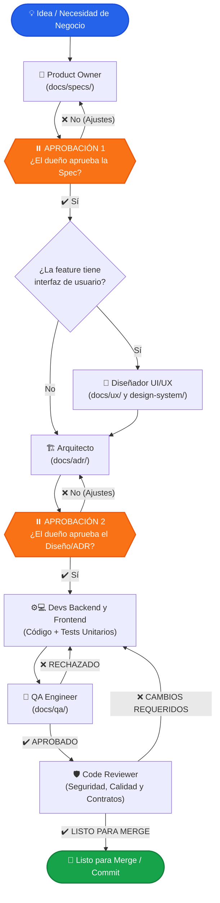

# 🚀 equipo-dev

[](LICENSE)
[](https://nodejs.org/)
[](docs/adr/001-reestructuracion-multi-ai.md)
[](tests/)
[](https://github.com/GeboArt-Dev/Equipo-Dev/pulls)

**Un equipo autónomo de desarrollo de software multi-rol con subagentes de IA para tu entorno de desarrollo.**  
Transforma ideas en código listo para producción, probado y revisado por pares, con aprobaciones humanas estructuradas y cero divergencia técnica.

---

### 🌐 Idioma / Language
[English](README.md) | **Español**

---

## 📖 Tabla de Contenidos

- [Resumen](#-resumen)
- [El Equipo y sus Roles](#-el-equipo-y-sus-roles)
- [Cómo Funciona (Flujo de Trabajo)](#-cómo-funciona-flujo-de-trabajo)
- [Aprobaciones Humanas Obligatorias](#-aprobaciones-humanas-obligatorias)
- [Guía de Instalación por SO y Plataforma](#-guía-de-instalación-por-so-y-plataforma)
  - [Google Antigravity](#1-google-antigravity)
  - [Claude Code](#2-claude-code)
  - [Cursor](#3-cursor)
  - [GitHub Copilot](#4-github-copilot)
- [Uso e Inicio Rápido](#-uso-e-inicio-rápido)
- [Requisitos de Configuración del Proyecto](#-requisitos-de-configuración-del-proyecto)
- [Arquitectura Multi-AI (`src/` + `platforms/`)](#-arquitectura-multi-ai-src--platforms)
- [Compilador CLI y Empaquetado](#-compilador-cli-y-empaquetado)
- [Pruebas Automatizadas](#-pruebas-automatizadas)
- [Cómo Contribuir](#-cómo-contribuir)
- [Licencia](#-licencia)

---

## 🌟 Resumen

`equipo-dev` transforma tu asistente de código con IA (Google Antigravity, Claude Code, Cursor o GitHub Copilot) en un **departamento completo de ingeniería de software**. En lugar de emitir un prompt aislado que genera código directo sin arquitectura ni pruebas, `equipo-dev` orquesta subagentes especializados siguiendo un ciclo de vida ágil y disciplinado:

1. **Requisitos e Historias de Usuario** (Product Owner)
2. **Diseño UI/UX y Sistema de Diseño** (UI/UX Designer, si la feature tiene interfaz)
3. **Decisiones de Arquitectura y Contratos de Datos** (Software Architect)
4. **Implementación y Pruebas Unitarias** (Backend y Frontend Developers)
5. **Aseguramiento de Calidad y Pruebas de Criterios** (QA Engineer)
6. **Auditoría de Seguridad y Revisión de Código** (Code Reviewer)

> [!IMPORTANT]
> **Tú eres el dueño y la autoridad final del proyecto.** El equipo se detiene obligatoriamente en dos puntos clave para solicitar tu aprobación explícita:
> 1. Tras la especificación del Product Owner (`docs/specs/`).
> 2. Tras el diseño técnico y contratos del Arquitecto (`docs/adr/`).

---

## 👥 El Equipo y sus Roles

| Avatar | Rol | Identificador | Responsabilidades Principales | Salidas Clave | Nivel de Modelo |
|:---:|---|---|---|---|:---:|
| 🎯 | **Product Owner** | `product-owner` | Transforma necesidades de negocio en historias de usuario con criterios de aceptación Gherkin y prioridad MoSCoW. | `docs/specs/<feature>.md` | `pro` (Opus / Pro) |
| 🎨 | **Diseñador UI/UX** | `ux-designer` | Diseña flujos de navegación, pantallas, estados (carga/vacío/error), accesibilidad y tokens de diseño. | `docs/ux/<feature>.md`<br>`design-system/` | `pro` (Opus / Pro) |
| 🏗️ | **Arquitecto de Software** | `architect` | Modela contratos REST/gRPC, esquemas de bases de datos, mitigaciones de seguridad y plan ordenado de tareas. | `docs/adr/<NNN>-<feature>.md` | `pro` (Opus / Pro) |
| ⚙️ | **Desarrollador Backend** | `backend-dev` | Implementa endpoints, lógica de negocio, persistencia y tests unitarios apegados al ADR. | Código fuente + Tests unitarios | `balanced` (Sonnet / Inherit) |
| 💻 | **Desarrollador Frontend** | `frontend-dev` | Construye pantallas, componentes interactivos y pruebas de interfaz respetando el diseño UX y tokens. | Código UI + Tests de componentes | `balanced` (Sonnet / Inherit) |
| 🧪 | **Ingeniero QA** | `qa-engineer` | Valida cada criterio de aceptación Gherkin, prueba casos límite y emite veredicto APROBADO o RECHAZADO. | `docs/qa/<feature>.md` | `balanced` (Sonnet / Inherit) |
| 🛡️ | **Revisor de Código** | `code-reviewer` | Auditoría de solo lectura: seguridad OWASP, calidad, rendimiento, cumplimiento del ADR y autorización de merge. | Informe de Revisión | `pro` (Opus / Pro) |

---

## 🔄 Cómo Funciona (Flujo de Trabajo)



---

## ⏸️ Aprobaciones Humanas Obligatorias

El flujo de trabajo establece dos pausas estructuradas en las que el equipo se detiene por completo esperando tu decisión:

1. **Aprobación de la Spec (`⏸ spec`)**:
   - El Product Owner produce `docs/specs/<feature>.md`.
   - Evalúas el alcance, criterios y prioridades antes de que se tome cualquier decisión técnica o de diseño.
2. **Aprobación del Diseño (`⏸ diseño`)**:
   - El Arquitecto entrega `docs/adr/<NNN>-<feature>.md` (y el diseñador entrega `docs/ux/<feature>.md` si aplica).
   - Revisas la estrategia técnica, contratos de API, base de datos y diseño visual antes de que se escriba una sola línea de código de producción.

---

## 💻 Guía de Instalación por SO y Plataforma

### Requisitos Previos
- **Node.js**: `v18.0.0` o superior (LTS recomendado). Verifica con:
  ```bash
  node -v
  ```
- **Git**: Instalado y configurado en el `PATH`. Verifica con:
  ```bash
  git --version
  ```
- **Python 3** *(Opcional)*: Solo requerido si se utiliza el subagente `ux-designer` con `ui-ux-pro-max`.

---

### Clonar el Repositorio

Clona `equipo-dev` en tu máquina local:

```bash
git clone https://github.com/GeboArt-Dev/Equipo-Dev.git
cd Equipo-Dev
```

---

### 1. Google Antigravity

Antigravity utiliza una estructura nativa de plugins con subagentes declarados en YAML, overrides de skills y registro de bitácora (`bitacora.mjs`).

#### Opción A: Compilación e Instalación Automática (Recomendada)

Ejecuta el compilador central con el parámetro `--install`:

```bash
node scripts/build.mjs --target antigravity --install
```

El instalador detecta el sistema operativo, genera los artefactos en `dist/antigravity/equipo-dev`, sincroniza los archivos en la ruta de plugins de Antigravity y preserva de manera segura el directorio `state/` (con tu bitácora histórica).

#### Opción B: Instalación Manual

Si prefieres compilar y copiar manualmente:

```bash
node scripts/build.mjs --target antigravity
```

Luego copia la carpeta `dist/antigravity/equipo-dev` al directorio correspondiente de tu sistema operativo:

| Sistema Operativo | Ruta Destino de Instalación | Comando PowerShell / Bash |
|---|---|---|
| **Windows** | `%USERPROFILE%\.gemini\config\plugins\equipo-dev` | `Copy-Item -Recurse -Force dist\antigravity\equipo-dev "$HOME\.gemini\config\plugins\"` |
| **macOS** | `~/.gemini/config/plugins/equipo-dev` | `mkdir -p ~/.gemini/config/plugins && cp -r dist/antigravity/equipo-dev ~/.gemini/config/plugins/` |
| **Linux** | `~/.gemini/config/plugins/equipo-dev` | `mkdir -p ~/.gemini/config/plugins && cp -r dist/antigravity/equipo-dev ~/.gemini/config/plugins/` |

#### Activación en Antigravity
1. Abre tu IDE de Antigravity / VS Code.
2. Abre la paleta de comandos (`Ctrl+Shift+P` en Windows/Linux, `Cmd+Shift+P` en macOS).
3. Ejecuta: **`Developer: Reload Window`**.
4. Las habilidades `/feature`, `/equipo-panel`, `/equipo-reiniciar` y los subagentes quedarán activos inmediatamente.

---

### 2. Claude Code

Claude Code soporta manifiestos en `.claude-plugin/plugin.json`, hooks en TypeScript y paneles laterales en vivo.

#### Paso 1: Compilar el Target de Claude Code

```bash
node scripts/build.mjs --target claude-code
```

Esto compila `src/` hacia `dist/claude-code/equipo-dev/`, traduciendo las herramientas agnósticas a las nativas de Claude (`Read`, `Write`, `Edit`, `Bash`, `Glob`, `Grep`, `WebSearch`) y mapeando los tiers a `opus` y `sonnet`.

#### Paso 2: Instalar el Plugin

| Sistema Operativo | Ruta Destino | Comando |
|---|---|---|
| **Windows (PowerShell)** | `%USERPROFILE%\.claude\plugins\equipo-dev` | `New-Item -ItemType Directory -Force "$HOME\.claude\plugins" ; Copy-Item -Recurse -Force dist\claude-code\equipo-dev "$HOME\.claude\plugins\"` |
| **macOS (Symlink o Copia)** | `~/.claude/plugins/equipo-dev` | `mkdir -p ~/.claude/plugins && ln -sfn "$(pwd)/dist/claude-code/equipo-dev" ~/.claude/plugins/equipo-dev` |
| **Linux (Symlink o Copia)** | `~/.claude/plugins/equipo-dev` | `mkdir -p ~/.claude/plugins && ln -sfn "$(pwd)/dist/claude-code/equipo-dev" ~/.claude/plugins/equipo-dev` |

#### Carga directa mediante CLI:
```bash
claude --plugin-dir dist/claude-code/equipo-dev
```

---

### 3. Cursor

Cursor opera mediante reglas globales o de repositorio (`.cursorrules` o `.cursor/rules/`).

1. Compila el target de Cursor:
   ```bash
   node scripts/build.mjs --target cursor
   ```
2. Archivos generados:
   - `dist/cursor/.cursorrules`: Plantilla consolidada lista para el repositorio.
3. Aplicar a un proyecto:
   ```bash
   # Windows (PowerShell)
   Copy-Item dist\cursor\.cursorrules "C:\ruta\a\tu-proyecto\.cursorrules"

   # macOS / Linux
   cp dist/cursor/.cursorrules /ruta/a/tu-proyecto/.cursorrules
   ```

---

### 4. GitHub Copilot

GitHub Copilot admite directivas de repositorio mediante `.github/copilot-instructions.md`.

1. Compila el target de Copilot:
   ```bash
   node scripts/build.mjs --target copilot
   ```
2. Aplicar a un proyecto:
   ```bash
   # Copiar al repositorio destino
   mkdir -p /ruta/a/tu-proyecto/.github
   cp dist/copilot/.github/copilot-instructions.md /ruta/a/tu-proyecto/.github/
   ```

---

## ⚡ Uso e Inicio Rápido

### 1. Iniciar una Nueva Feature
En el chat de tu asistente, escribe `/feature` seguido de lo que deseas construir:

```text
/feature autenticacion con OAuth2 y tokens de refresco
```

El orquestador convoca al **Product Owner**, genera `docs/specs/autenticacion.md` y pausa esperando tu aprobación.

### 2. Retomar una Feature Existente
Si cerraste la sesión o cambiaste de rama, retoma el trabajo sin perder el avance:

```text
/feature continuemos con autenticacion
```

El equipo inspecciona `docs/specs/`, `docs/ux/`, `docs/adr/` y `docs/qa/`, revisa `git status` y te propone continuar exactamente desde el paso pendiente sin rehacer lo completado.

### 3. Consultar el Estado del Equipo (`/equipo-panel`)
Revisa en tiempo real el progreso de los roles y aprobaciones pendientes:

```text
/equipo-panel
```

Ejemplo de respuesta:
```text
Feature: autenticacion
✔ 1. Product Owner
○ 2. Diseño UX (no aplica)
✔ 3. Arquitecto
● 4. Backend (3 de 5 tareas completadas)
○ 5. Frontend
○ 6. QA
○ 7. Code Reviewer
Bitácora: Backend dev añadió tests de validación de JWT
Siguiente paso: Backend dev completando la tarea 4 (endpoint de refresco)
```

### 4. Reiniciar la Bitácora de Sesión (`/equipo-reiniciar`)
Limpia el registro de la feature actual para iniciar una completamente nueva:

```text
/equipo-reiniciar
```

---

## 📁 Requisitos de Configuración del Proyecto

Para que `equipo-dev` trabaje de forma óptima en tu proyecto, es necesario un archivo de contexto en su raíz:
- `AGENTS.md` (recomendado), `CLAUDE.md` o `GEMINI.md`.

Debe contener:
1. **Stack Tecnológico y Versiones**: (ej. TypeScript 5, Node 20, PostgreSQL, React 19).
2. **Comandos de Trabajo**:
   - Instalación: `npm install` / `pnpm install` / `cargo build`
   - Pruebas: `npm test` / `pytest`
   - Ejecución: `npm run dev`
   - Linter: `npm run lint`
3. **Restricciones y Directrices Arquitectónicas**.

Las salidas generadas por el equipo se guardan ordenadamente dentro de tu repositorio:
```text
tu-proyecto/
├── AGENTS.md                          # Guía obligatoria del proyecto
├── design-system/                     # Tokens y estilos (si aplica UX)
└── docs/
    ├── specs/<feature>.md             # Especificaciones del Product Owner
    ├── ux/<feature>.md                # Flujos de pantalla y estados del diseñador
    ├── adr/<NNN>-<feature>.md         # Decisiones de arquitectura y contratos
    └── qa/<feature>.md                # Informes de pruebas de QA
```

---

## 🏛️ Arquitectura Multi-AI (`src/` + `platforms/`)

`equipo-dev` está diseñado bajo el patrón **Fuente-Adaptador-Target (Source-Adapter-Target)**, desacoplando la lógica de negocio de las APIs propietarias:

```text
Equipo-Dev/
├── src/                               # 🌟 FUENTE ÚNICA DE VERDAD (Agnóstica)
│   ├── manifest.json                  # Metadatos canónicos
│   ├── agents/                        # 7 roles con herramientas y tiers canónicos
│   └── skills/                        # 4 skills con tokens semánticos ({{CMD_TOOL}}, etc.)
│
├── platforms/                         # 🔌 ADAPTADORES MODULARES POR PLATAFORMA
│   ├── antigravity/                   # Mapeos, hooks y overrides de skills para Antigravity
│   ├── claude-code/                   # Mapeos, hooks TypeScript y tipos para Claude Code
│   ├── cursor/                        # Plantillas y contratos para reglas de Cursor
│   └── copilot/                       # Plantillas y contratos para instrucciones de Copilot
│
├── scripts/
│   └── build.mjs                      # ⚡ Compilador nativo Node.js sin dependencias
│
├── tests/
│   ├── build.test.mjs                 # Suite de integridad del compilador y regresión
│   └── qa-verification.test.mjs       # Suite de verificación de criterios de aceptación
│
└── dist/                              # 📦 ARTEFACTOS COMPILADOS POR PLATAFORMA
    ├── antigravity/equipo-dev/
    ├── claude-code/equipo-dev/
    ├── cursor/
    └── copilot/
```

### Fortalezas de la Arquitectura:
- **Cero Divergencia**: Actualizar un prompt en `src/agents/` se propaga inmediatamente a todas las plataformas.
- **Prevención de Path Traversal**: El compilador valida la contención de destinos mediante `assertWithin` y restringe rutas de instalación autorizadas (`isAuthorizedInstallTarget`).
- **Operaciones Atómicas**: Preservación selectiva (`preserve: ["state"]`) para no sobrescribir la bitácora de usuario.
- **Cero Dependencias Externas**: Funciona 100% con APIs nativas de Node.js 18+ (`node:fs`, `node:path`, `node:os`).

---

## 🛠️ Compilador CLI y Empaquetado

El CLI del compilador soporta compilación selectiva, limpieza previa e instalación local:

```bash
# Compilar todos los targets hacia dist/
node scripts/build.mjs

# Compilar un target específico
node scripts/build.mjs --target antigravity
node scripts/build.mjs --target claude-code
node scripts/build.mjs --target cursor
node scripts/build.mjs --target copilot

# Limpiar dist/ antes de compilar
node scripts/build.mjs --clean

# Limpiar selectivamente solo un target
node scripts/build.mjs --clean --target antigravity

# Compilar e instalar localmente en Antigravity
node scripts/build.mjs --target antigravity --install

# Ver ayuda del CLI
node scripts/build.mjs --help
```

---

## 🧪 Pruebas Automatizadas

El repositorio cuenta con una suite integral de **29 pruebas en verde**:
- **`tests/build.test.mjs`** (14 pruebas): Valida integridad de manifiestos, mapeo de herramientas, resolución de tiers, formato de frontmatter, contención de rutas (`assertWithin`) y autorización de destinos.
- **`tests/qa-verification.test.mjs`** (15 pruebas): Valida los criterios de aceptación Gherkin (HU-1 a HU-5), casos límite, instalación aislada en directorios temporales y cero regresiones.

Ejecutar las suites de pruebas de forma nativa:

```bash
# Pruebas del compilador
node --test tests/build.test.mjs

# Pruebas de verificación de QA
node --test tests/qa-verification.test.mjs

# Ejecución conjunta secuencial
node --test --test-concurrency=1 tests/build.test.mjs tests/qa-verification.test.mjs
```

---

## 🤝 Cómo Contribuir

¡Toda contribución es bienvenida! Debido a la arquitectura multi-AI:
1. **Nunca edites archivos dentro de `dist/` directamente**, ya que son generados automáticamente.
2. Modifica roles o habilidades en **`src/`**.
3. Modifica adaptadores, hooks o plantillas en **`platforms/<plataforma>/`**.
4. Compila con `node scripts/build.mjs` y asegura que los tests pasen con `node --test tests/build.test.mjs` antes de enviar un Pull Request.

---

## 📄 Licencia

Este proyecto está distribuido bajo la licencia [MIT](LICENSE).

---

<p align="center">
  Desarrollado con dedicación por <strong><a href="https://github.com/GeboArt-Dev">GeboArt.Dev</a></strong><br>
  Empoderando a desarrolladores con equipos autónomos y estructurados de IA.
</p>

