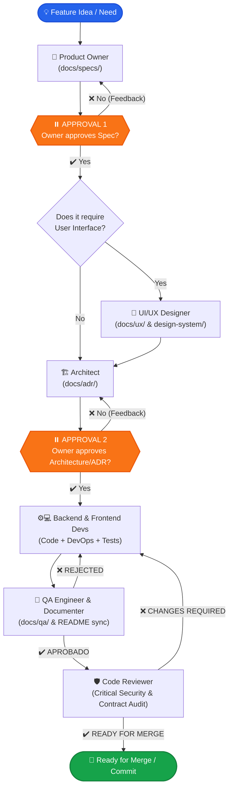

# 🚀 equipo-dev

[](CHANGELOG.md)
[](LICENSE)
[](https://nodejs.org/)
[](docs/adr/001-reestructuracion-multi-ai.md)
[](tests/)
[](https://github.com/GeboArt-Dev/Equipo-Dev/pulls)

**An autonomous, multi-role software development team of AI subagents for your coding workspace.**  
Transform feature ideas into production-ready, peer-reviewed code with human-in-the-loop approvals, structured artifacts, and zero technical drift.

---

### 🌐 Language / Idioma
**English** | [Español](README.es.md) | [Changelog](CHANGELOG.md)

---

## 📖 Table of Contents

- [Overview](#-overview)
- [The Team & Roles](#-the-team--roles)
- [How It Works (Workflow)](#-how-it-works-workflow)
- [Human-in-the-Loop Approvals](#-human-in-the-loop-approvals)
- [Execution Modes & Safeguards](#-execution-modes--safeguards)
- [Installation Guide by OS & Platform](#-installation-guide-by-os--platform)
  - [Google Antigravity](#1-google-antigravity)
  - [Claude Code](#2-claude-code)
  - [Cursor](#3-cursor)
  - [GitHub Copilot](#4-github-copilot)
  - [Codex](#5-codex)
- [Quick Start & Usage](#-quick-start--usage)
- [Project Configuration Requirements](#-project-configuration-requirements)
- [Multi-AI Architecture (`src/` + `platforms/`)](#-multi-ai-architecture-src--platforms)
- [Compiler CLI & Building](#-compiler-cli--building)
- [Automated Tests](#-automated-tests)
- [New Capabilities & Technical Reference](#-nuevas-capacidades-y-cambios-skill-fix-resolucion-problemas)
- [Changelog](CHANGELOG.md)
- [Contributing](#-contributing)
- [License](#-license)

---

## 🌟 Overview

`equipo-dev` turns your AI coding assistant (Google Antigravity, Claude Code, Cursor, or GitHub Copilot) into a **disciplined software engineering department**. Instead of an unstructured prompt that writes code directly without design or testing, `equipo-dev` orchestrates specialized subagents through an agile software lifecycle:

1. **Requirements & User Stories** (Product Owner)
2. **UI/UX & Design System** (UI/UX Designer, when UI applies)
3. **Architecture Decision Records & API Contracts** (Software Architect)
4. **Implementation, DevOps & Unit Tests** (Backend & Frontend Developers)
5. **Quality Assurance, Minimal Suites & Continuous Documentation** (QA Engineer)
6. **Security & Critical Code Review** (Code Reviewer)

> [!IMPORTANT]
> **You remain the owner and final authority.** The team pauses at two critical stages for your explicit approval:
> 1. After the Product Owner produces the **Specification** (`docs/specs/`).
> 2. After the Architect produces the **Technical Design / ADR** (`docs/adr/`).

---

## 👥 The Team & Roles

| Avatar | Role | Name | Responsibilities | Key Outputs | Model Tier |
|:---:|---|---|---|---|:---:|
| 🎯 | **Product Owner** | `product-owner` | First-sentence problem diagnosis, epistemic calibration (`[Seguro]`, `[Probable]`, `[Especulando]`), user stories with Gherkin acceptance criteria, and MoSCoW prioritization. | `docs/specs/<feature>.md` | `pro` (Opus / Pro) |
| 🎨 | **UI/UX Designer** | `ux-designer` | Mobile-first screen flows (< 640px base), design system token binding, WCAG 2.1 AA accessibility checklists, and concise design rationale. | `docs/ux/<feature>.md`<br>`design-system/` | `pro` (Opus / Pro) |
| 🏗️ | **Software Architect** | `architect` | First-sentence technical diagnosis, epistemic calibration, data schemas, API contracts, security mitigations, and task assignments for backend/DevOps, frontend, and QA/documentation. | `docs/adr/<NNN>-<feature>.md` | `pro` (Opus / Pro) |
| ⚙️ | **Backend Developer** | `backend-dev` | Full executable backend code, database query optimization (no N+1), integrated DevOps (multi-stage Dockerfiles & CI/CD YAML), zero plain secrets, comments ≤ 1 line. | Source code + Unit tests + Docker/CI-CD | `balanced` (Sonnet / Inherit) |
| 💻 | **Frontend Developer** | `frontend-dev` | Mobile-first layout (< 640px base), WCAG 2.1 AA compliance (contrast ≥ 4.5:1, touch target ≥ 44px), 5 UI states coverage, and README design documentation. | UI code + Component tests | `balanced` (Sonnet / Inherit) |
| 🧪 | **QA Engineer** | `qa-engineer` | Minimal essential test suites (1 happy path + critical edge cases per Gherkin criterion), integrated Documenter (continuous README & technical reference updates), and binary verdict. | `docs/qa/<feature>.md` + README updates | `balanced` (Sonnet / Inherit) |
| 🛡️ | **Code Reviewer** | `code-reviewer` | Exclusive critical-only audit (blocking security vulnerabilities, ADR contract violations, regressions; zero stylistic noise), single-line findings, binary verdict. | Review Report (Blocking only) | `pro` (Opus / Pro) |

---

## 🔄 How It Works (Workflow)



---

## ⏸️ Human-in-the-Loop Approvals

The workflow enforces two structured design gates where the team halts and awaits your decision in supervised mode:

1. **Spec Approval (`⏸ spec`)**:
   - The Product Owner delivers `docs/specs/<feature>.md`.
   - You review scope, acceptance criteria, and priority before any technical or design decisions are made.
2. **Design Approval (`⏸ diseño`)**:
   - The Architect delivers `docs/adr/<NNN>-<feature>.md` (and `docs/ux/<feature>.md` if applicable).
   - You review the technical strategy, dependencies, database changes, and UI layout before a single line of production code is written.

---

## 🎛️ Execution Modes & Safeguards

`equipo-dev` provides two execution modes to balance governance and velocity:

### 1. Supervised / Interactive Mode (Default)
- **Invocation**: `/feature <description>` or `/feature continue with <name>`.
- **Behavior**: Pauses deterministically at Gate 1 (Spec approval) and Gate 2 (UX + ADR approval).
- **Ideal for**: Complex features, domain-critical logic, or when close human oversight is required.

### 2. Continuous / Autonomous Mode (`--no-pause` / `--auto-approve`)
- **Invocation**: `/feature --no-pause <description>` or `/feature --auto-approve <description>`.
- **Behavior**: Bypasses design gates (Spec and UX/ADR). Transitions smoothly from Product Owner directly to UX/Architect and then to Developers.
- **Ambiguity Rule**: If non-blocking technical questions arise, the team adopts simplest reasonable technical assumptions and documents them in the artifacts. If a blocking business ambiguity arises, it halts and requests human clarification.
- **Ideal for**: Rapid prototyping, unattended execution, or automated developer pipelines.

> [!CAUTION]
> ### 🛡️ Inviolable Security Safeguards (Both Modes)
> Continuous mode **never** bypasses critical security gates. The following actions **strictly pause and demand explicit human approval**:
> 1. **Git Commits & Pushes**: Never commit or push without explicit owner consent.
> 2. **Destructive Commands**: Dropping tables, deleting directories, or altering infrastructure.
> 3. **Persistent QA/Review Failures**: On 3 consecutive QA rejections or unresolved blocking reviewer findings, execution halts immediately and escalates to the owner.

---

## 💻 Installation Guide by OS & Platform

### Prerequisites
- **Node.js**: `v18.0.0` or higher (LTS recommended). Check with:
  ```bash
  node -v
  ```
- **Git**: Installed and available in your `PATH`. Check with:
  ```bash
  git --version
  ```
- **Python 3** *(Optional)*: Only required if using the `ux-designer` agent with `ui-ux-pro-max`.

---

### Clone the Repository

Clone `equipo-dev` to your local machine:

```bash
git clone https://github.com/GeboArt-Dev/Equipo-Dev.git
cd Equipo-Dev
```

---

### 1. Google Antigravity

Antigravity uses a native plugin structure with subagents, skill overrides, and a session logger (`bitacora.mjs`).

#### Option A: Automated Build & Install (Recommended)

Run the unified compiler with the `--install` flag:

```bash
node scripts/build.mjs --target antigravity --install
```

The installer automatically detects your operating system, compiles the target to `dist/antigravity/equipo-dev`, copies the plugin to the correct path, and safely preserves your historical state (`bitacora.jsonl`).

#### Option B: Manual Installation

If you prefer manual installation, build the artifacts and copy them:

```bash
node scripts/build.mjs --target antigravity
```

Then copy the folder `dist/antigravity/equipo-dev` to the appropriate path:

| Operating System | Target Installation Directory | PowerShell / Bash Command |
|---|---|---|
| **Windows** | `%USERPROFILE%\.gemini\config\plugins\equipo-dev` | `Copy-Item -Recurse -Force dist\antigravity\equipo-dev "$HOME\.gemini\config\plugins\"` |
| **macOS** | `~/.gemini/config/plugins/equipo-dev` | `mkdir -p ~/.gemini/config/plugins && cp -r dist/antigravity/equipo-dev ~/.gemini/config/plugins/` |
| **Linux** | `~/.gemini/config/plugins/equipo-dev` | `mkdir -p ~/.gemini/config/plugins && cp -r dist/antigravity/equipo-dev ~/.gemini/config/plugins/` |

#### Activating in Antigravity
1. Open your Antigravity IDE / VS Code.
2. Open the Command Palette (`Ctrl+Shift+P` on Windows/Linux, `Cmd+Shift+P` on macOS).
3. Run: **`Developer: Reload Window`**.
4. The `/feature`, `/fix`, `/team-report`, and `/equipo-reiniciar` skills, as well as the subagents, are now active.

---

### 2. Claude Code

Claude Code supports native plugin manifests (`.claude-plugin/plugin.json`), custom TypeScript hooks, and live side panels.

#### Step 1: Compile the Claude Code Target

```bash
node scripts/build.mjs --target claude-code
```

This compiles `src/` into `dist/claude-code/equipo-dev/` with canonical tools mapped to Claude tools (`Read`, `Write`, `Edit`, `Bash`, `Glob`, `Grep`, `WebSearch`) and model tiers mapped to `opus` and `sonnet`.

#### Step 2: Install the Plugin

| Operating System | Target Location | Command |
|---|---|---|
| **Windows (PowerShell)** | `%USERPROFILE%\.claude\plugins\equipo-dev` | `New-Item -ItemType Directory -Force "$HOME\.claude\plugins" ; Copy-Item -Recurse -Force dist\claude-code\equipo-dev "$HOME\.claude\plugins\"` |
| **macOS (Symlink or Copy)** | `~/.claude/plugins/equipo-dev` | `mkdir -p ~/.claude/plugins && ln -sfn "$(pwd)/dist/claude-code/equipo-dev" ~/.claude/plugins/equipo-dev` |
| **Linux (Symlink or Copy)** | `~/.claude/plugins/equipo-dev` | `mkdir -p ~/.claude/plugins && ln -sfn "$(pwd)/dist/claude-code/equipo-dev" ~/.claude/plugins/equipo-dev` |

#### Alternatively, load via CLI:
```bash
claude --plugin-dir dist/claude-code/equipo-dev
```

---

### 3. Cursor

Cursor relies on global or repository-level rules (`.cursorrules` or `.cursor/rules/`).

1. Compile the Cursor target:
   ```bash
   node scripts/build.mjs --target cursor
   ```
2. Generated files:
   - `dist/cursor/.cursorrules`: Ready to copy into your project root.
3. Apply to a project:
   ```bash
   # Windows (PowerShell)
   Copy-Item dist\cursor\.cursorrules "C:\path\to\your-project\.cursorrules"

   # macOS / Linux
   cp dist/cursor/.cursorrules /path/to/your-project/.cursorrules
   ```

---

### 4. GitHub Copilot

GitHub Copilot supports repository-level instructions via `.github/copilot-instructions.md`.

1. Compile the Copilot target:
   ```bash
   node scripts/build.mjs --target copilot
   node scripts/build.mjs --target codex
   ```
2. Apply to a project:
   ```bash
   # Copy to your target repository
   mkdir -p /path/to/your-project/.github
   cp dist/copilot/.github/copilot-instructions.md /path/to/your-project/.github/
   ```

---

### 5. Codex

Requires Node.js 18+, a local Codex client with user skills, and host-authorized subagent delegation. Windows and the client used in the 2026-10-15 session passed a user-guided functional smoke test; the exact client version was not captured ([QA evidence](docs/qa/instalacion-codex.md)). Other clients and operating systems are not certified.

```bash
# Generate without changing your profile
node scripts/build.mjs --target codex
# Install or update only Codex for the current user
node scripts/build.mjs --target codex --install
```

Output: `dist/codex/equipo-dev/`. Installation manages five folders in `.agents/skills` under Node.js `os.homedir()` (normally `%USERPROFILE%\.agents\skills` on Windows), plus `.equipo-dev-install` metadata. It does not edit Codex configuration, credentials, project instructions or unprefixed skills. Use the installer instead of manual copying to preserve ownership tracking.

| Skill | Purpose |
|---|---|
| `equipo-dev-feature` | Delegates seven role resources and preserves spec/ADR approval gates. |
| `equipo-dev-fix` | Executes direct technical bugfix circuit (Dev -> QA -> Reviewer) with regression test. |
| `equipo-dev-team-rules` | Loads shared team rules. |
| `equipo-dev-team-report` | Reports inspected artifacts, approvals and pending validation in text. |
| `equipo-dev-team-reset` | Explains that there is no persistent panel to reset; preserves documents. |

Check all five names in the client's skill selector; restart if needed. Select `equipo-dev-feature` or `equipo-dev-fix` explicitly (CLI/IDE may expose `$equipo-dev-feature` or `/skills`; syntax depends on the host). Installation success confirms files, not recognition. In a disposable project, request a small feature, check its spec approval pause, then select `equipo-dev-team-report` and verify approval is pending. These functional checks are required before certifying a client.

The seven Markdown roles live in `equipo-dev-feature/references/agents`; they are not registered native agents. Models, tools and permissions come from the host. Without authorized delegation, feature execution pauses before the affected role; reporting remains available. UX needs external `ui-ux-pro-max` and Python 3, neither installed by this package; features without UI skip UX. Codex has no package hooks or live panel.

Repeat installation to update owned files and retire unchanged obsolete resources while preserving unrelated files. Close/restart the client during updates if it might observe intermediate resources. `--clean --target codex` only cleans generated output. `--target all --install` may install other targets too; use `--target codex` for Codex alone.

#### Conflicts and recovery

- `CODEX_CONFLICT`: preserve the reported customization outside managed paths, compare it with the source, then deliberately restore the previous managed version or move an unowned conflicting file before retrying; there is no implicit force overwrite.
- `CODEX_SOURCE_INVALID`, `CODEX_PATH_UNSAFE`, `CODEX_PERMISSION`: fix missing/altered sources, unsafe paths or permissions and rebuild; managed symlinks/junctions are rejected.
- `CODEX_INSTALL_BUSY`: check for an active installer; never remove an active lock. A stale lock without journal/transaction can be removed only after confirming no installer is running.
- `CODEX_INSTALL_INCOMPLETE`: preserve `journal.json` and `transaction/` backups in `.equipo-dev-install`, stop installers and inspect the reported conflict before recovery. Recovery checks hashes and refuses subsequent edits; preserve and resolve them first. A transaction without a readable journal needs manual inspection; do not delete backups blindly.

From the repository, recover the default user installation, then retry installation:

```bash
node --input-type=module -e "import { recoverCodex } from './scripts/codex.mjs'; recoverCodex();"
```

Recovery restores the previous installation or finishes cleanup of a committed one. No arbitrary destination CLI is exposed. Multi-file updates are not atomic across system crashes. Automated installation tests use temporary directories, never the personal profile.

---

## ⚡ Quick Start & Usage

For Codex, use the prefixed skills and host selector above; the slash commands and live log examples below apply to other adapters.

### 1. Start a New Feature (Supervised vs Continuous)
In your AI assistant's chat, type `/feature` followed by what you want to build:

```text
# Standard Supervised Mode (halts at Spec and UX/ADR approvals)
/feature user authentication with OAuth2 and refresh tokens

# Continuous Autonomous Mode (bypasses design gates)
/feature --no-pause user authentication with OAuth2 and refresh tokens
# or
/feature --auto-approve user authentication with OAuth2 and refresh tokens
```

In supervised mode, the orchestrator invokes the **Product Owner**, produces `docs/specs/user-authentication.md`, and pauses for your approval. In continuous mode, it validates scope, logs any non-blocking assumptions, and continues automatically into design and implementation.

### 2. Fast Bug Fixing and Regressions (`/fix`)
When resolving runtime errors, broken test assertions, or regressions, use `/fix` with a description or error trace:

```text
/fix Cannot read properties of undefined (reading 'status')
# or with an affected file path:
/fix src/auth/token.ts expired token validation throwing unhandled error
```

#### Comparison: `/feature` vs `/fix`

| Aspect / Flow | `/feature` (Full Agile Cycle) | `/fix` (Rapid Technical Remediation) |
|---|---|---|
| **Primary Scope** | New features, domain user stories | Surgical bug fixes, runtime crashes, regressions |
| **Participating Roles** | PO → UX → Architect → Devs → QA → Reviewer (7 roles) | Dev (Backend or Frontend) → QA → Reviewer (3 roles) |
| **Intermediate Pauses** | 2 mandatory design approvals (Spec and UX/ADR) | Zero intermediate pauses (continuous technical loop) |
| **Regression Test** | Recommended based on scope | **Mandatory** (must reproduce defect before patch) |
| **Persisted Artifact** | `docs/specs/`, `docs/ux/`, `docs/adr/`, `docs/qa/` | `docs/fixes/<slug>.md` (root cause, patch, tests) |
| **Token Consumption** | 40,000 to 80,000+ tokens | **60% to 75% savings** (~10,000 to 20,000 tokens) |
| **Cycle Latency** | Full architectural alignment cycle | **≥ 50% reduction** in time to verified resolution |
| **Critical Safeguards** | Zero unapproved commits/push; max 3 QA retries | **Identical**: zero unapproved commits/push; max 3 retries |

### 3. Resume an In-Progress Feature
If you closed your session or switched branches, resume seamlessly:

```text
# Resume in Supervised Mode (default)
/feature continue with user-authentication

# Resume in Continuous Mode
/feature continue with user-authentication --no-pause
```

The team inspects `docs/specs/`, `docs/ux/`, `docs/adr/`, and `docs/qa/`, analyzes git status, and proposes resuming from the exact unfinished step without repeating completed work.

### 4. Check Live Team Status (`/team-report`)
At any time, inspect team progress, active execution mode, and pending approvals:

```text
/team-report
```

Output format in Supervised Mode:
```text
Feature: user-authentication
Modo: Supervisado / Interactivo
⏸ Esperando aprobación de spec
✔ 1. Product Owner
○ 2. UI/UX Design (not applicable)
○ 3. Architect
○ 4. Backend
○ 5. Frontend
○ 6. QA
○ 7. Code Reviewer
Next step: Awaiting owner approval of docs/specs/user-authentication.md
```

Output format in FIX Mode:
```text
Fix: unhandled-token-expiry
Tipo: FIX
Modo: Remediación directa (Dev -> QA -> Reviewer)
✔ 1. Dev (Backend): terminado · 1m
✔ 2. QA: APROBADO (suite completa sin regresiones)
✔ 3. Code Reviewer: APROBADO (sin hallazgos de seguridad)
Siguiente paso: Cierre y autorización del dueño para commit/push
```

### 5. Reset Session Log (`/equipo-reiniciar`)
Clean the session history before starting a completely fresh feature:

```text
/equipo-reiniciar
```

---

## 📁 Project Configuration Requirements

For `equipo-dev` to function optimally in any project, the project must include a guide file in its root:
- `AGENTS.md` (recommended standard), `CLAUDE.md`, or `GEMINI.md`.

This file must specify:
1. **Tech Stack & Versions**: (e.g. TypeScript 5, Node 20, PostgreSQL, React 19).
2. **Commands**:
   - Install: `npm install` / `pnpm install` / `cargo build`
   - Test: `npm test` / `pytest`
   - Run: `npm run dev`
   - Lint / Format: `npm run lint`
3. **Architectural Guidelines & Restrictions**.

The team automatically writes all documentation into your repository:
```text
your-project/
├── AGENTS.md                          # Mandatory project guidelines
├── design-system/                     # UI tokens & style guide (if UI)
└── docs/
    ├── specs/<feature>.md             # Product Owner specifications
    ├── ux/<feature>.md                # UI/UX screen flows & states
    ├── adr/<NNN>-<feature>.md         # Architecture Decision Records
    ├── fixes/<slug>.md                # Rapid bugfix remediation records
    └── qa/<feature>.md                # QA integration test reports
```

---

## 🏛️ Multi-AI Architecture (`src/` + `platforms/`)

`equipo-dev` is engineered using a **Source-Adapter-Target Pattern** that completely separates business logic from platform-specific APIs:

```text
Equipo-Dev/
├── src/                               # 🌟 SINGLE SOURCE OF TRUTH (Platform-Agnostic)
│   ├── manifest.json                  # Canonical metadata
│   ├── agents/                        # 7 team roles with canonical tools & model tiers
│   └── skills/                        # 5 skills with semantic tokens ({{CMD_TOOL}}, etc.)
│
├── platforms/                         # 🔌 MODULAR PLATFORM ADAPTERS
│   ├── antigravity/                   # Google Antigravity mappings, hooks & skill overrides
│   ├── claude-code/                   # Claude Code mappings, TypeScript hooks & types
│   ├── cursor/                        # Cursor templates & .cursorrules generator
│   └── copilot/                       # Copilot templates & instructions generator
│
├── scripts/
│   ├── build.mjs                      # ⚡ Zero-dependency native Node.js compiler
│   └── codex.mjs                      # Codex packaging and installation manager
│
├── tests/
│   ├── build.test.mjs                 # Compiler integrity & regression test suite
│   ├── qa-verification.test.mjs       # Acceptance verification suite
│   ├── agent-optimization.test.mjs    # Agent optimization & token frugality suite
│   ├── codex.test.mjs                 # Codex package, installer and recovery test suite
│   ├── approval-control.test.mjs      # Approval mode control & safety safeguards suite
│   └── fix-skill.test.mjs             # Rapid bugfix skill contracts and validation suite
│
└── dist/                              # 📦 COMPILED TARGET ARTIFACTS
    ├── antigravity/equipo-dev/
    ├── claude-code/equipo-dev/
    ├── cursor/
    └── copilot/
```

### Key Architectural Strengths:
- **Zero Drift**: Editing a prompt in `src/agents/` immediately propagates to Claude Code, Antigravity, Cursor, and Copilot.
- **Path Traversal Protection**: Compiler strictly enforces destination containment via `assertWithin` and validates install directories (`isAuthorizedInstallTarget`).
- **Atomic Operations**: State preservation (`preserve: ["state"]`) prevents overwriting session logs.
- **Zero External Dependencies**: Operates exclusively with native Node.js 18+ ESM modules (`node:fs`, `node:path`, `node:os`).

---

## 🛠️ Compiler CLI & Building

The compiler CLI supports selective builds, pre-cleaning, and local installation:

```bash
# Build all platforms into dist/
node scripts/build.mjs

# Build a single target
node scripts/build.mjs --target antigravity
node scripts/build.mjs --target claude-code
node scripts/build.mjs --target cursor
node scripts/build.mjs --target copilot
node scripts/build.mjs --target codex

# Clean dist/ before building
node scripts/build.mjs --clean

# Clean only a specific target
node scripts/build.mjs --clean --target antigravity

# Build and install locally (single platform)
node scripts/build.mjs --target antigravity --install
node scripts/build.mjs --target claude-code --install
node scripts/build.mjs --target codex --install

# 🚀 Build and install to ALL supported platforms simultaneously (Antigravity, Claude Code, Codex)
node scripts/build.mjs --install-all

# Or using npm:
npm run install:all

# Display CLI help
node scripts/build.mjs --help
```

---

## 🧪 Automated Tests

The repository includes a comprehensive automated test suite with **66 automated tests**:
- **`tests/approval-control.test.mjs`** (7 tests): Validates parsing of `--no-pause` and `--auto-approve`, supervised fallback, contract enforcement across platforms, safety safeguards, and multi-target compilation without tokens.
- **`tests/codex.test.mjs`** (13 tests): Validates deterministic generation, temporary installation, preservation, conflicts, junction rejection, rollback and recovery; it does not certify client execution.
- **`tests/build.test.mjs`** (14 tests): Validates manifest integrity, tool mapping, tier resolution, frontmatter serialization, path containment (`assertWithin`), and install target authorization.
- **`tests/qa-verification.test.mjs`** (15 tests): Validates Gherkin acceptance criteria (HU-1 through HU-5), edge cases, isolated installation, and zero regressions.
- **`tests/agent-optimization.test.mjs`** (8 tests): Validates prompt optimization rules, token frugality, epistemic calibration (`[Seguro]`, `[Probable]`, `[Especulando]`), DevOps integration in Backend, mobile-first and WCAG 2.1 AA in UX/Frontend, Documenter role in QA, and critical-only filtering in Code Reviewer.
- **`tests/fix-skill.test.mjs`** (9 tests/assertions): Validates invocation syntax, parameter enforcement, contract assertions in canonical files, compact reporting, multi-platform adapters, and safety safeguards for `/fix`.

Run the entire test suite natively:

```bash
# Run compiler tests
node --test tests/build.test.mjs

# Run QA verification tests
node --test tests/qa-verification.test.mjs

# Run agent optimization tests
node --test tests/agent-optimization.test.mjs

# Run approval control tests
node --test tests/approval-control.test.mjs

# Run fix skill tests
node --test tests/fix-skill.test.mjs

# Run all test suites sequentially (recommended on Windows to prevent dist/ file locking)
node --test --test-concurrency=1 tests/build.test.mjs tests/qa-verification.test.mjs tests/agent-optimization.test.mjs tests/codex.test.mjs tests/approval-control.test.mjs tests/fix-skill.test.mjs
```

---

### 📦 Nuevas Capacidades y Cambios (skill-fix-resolucion-problemas)

Introduce la habilidad canónica `/fix` para la remediación rápida y quirúrgica de defectos técnicos, excepciones en tiempo de ejecución y regresiones mediante un circuito directo Dev -> QA -> Code Reviewer. Reduce entre un 60% y un 75% el consumo de tokens y acorta la latencia a la mitad frente a `/feature`, exigiendo un test de regresión automatizado obligatorio y registrando un reporte sintético en `docs/fixes/<slug>.md`.

### 🔧 Referencia Técnica de Funciones y Hooks

| Identificador | Ubicación | Descripción (1 frase corta) |
|---|---|---|
| `validateFixInvocation` | `tests/fix-skill.test.mjs` | Valida sintaxis obligatoria de `/fix` requiriendo descripción no vacía. |
| `parseKind` | `platforms/claude-code/hooks/register.tsx` | Identifica si la invocación corresponde a un flujo de tipo fix o feature. |
| `startsNewFlow` | `platforms/claude-code/hooks/register.tsx` | Permite el inicio autónomo de un flujo fix directamente desde desarrolladores técnicos. |
| `fix` (Agnóstico) | `src/skills/fix/SKILL.md` | Habilidad canónica que orquesta el circuito directo Dev -> QA -> Reviewer con test de regresión obligatorio. |
| `team-report` (FIX) | `src/skills/team-report/SKILL.md` | Reporta el estado suprimiendo roles de negocio y compuertas de diseño en modo FIX. |
| `SKILLS.fix` | `scripts/codex.mjs` | Registra el paquete y recurso de distribución para la skill fix en Codex. |

---

### 📦 Nuevas Capacidades y Cambios (control-aprobaciones-equipo)

Introduce los modificadores idempotentes `--no-pause` y `--auto-approve` para `/feature`, permitiendo alternar deterministamente entre el Modo Supervisado estándar y el Modo Continuo/Autónomo sin esperas intermedias de diseño. Mantiene intactas las compuertas críticas de seguridad (commits, push y comandos destructivos) y refleja el modo operativo en cabeceras y reportes.

### 🔧 Referencia Técnica de Funciones y Hooks

| Identificador | Ubicación | Descripción (1 frase corta) |
|---|---|---|
| `parseCommandMode` | `tests/approval-control.test.mjs` | Parsea comandos de `/feature` para extraer modificadores continuos y sanitizar la descripción de la feature. |
| `parseMode` | `platforms/claude-code/hooks/register.tsx` | Analiza argumentos de la invocación para resolver el modo (`supervised` o `continuous`) en Claude Code. |
| `summary` | `platforms/claude-code/hooks/register.tsx` | Renderiza el estado del panel suprimiendo indicadores `⏸` en modo continuo e informando el modo activo. |
| `feature` (Agnóstico) | `src/skills/feature/SKILL.md` | Habilidad canónica con soporte para omitir compuertas 1 y 2 bajo supuestos razonables en modo continuo. |
| `reglas-equipo` | `src/skills/reglas-equipo/SKILL.md` | Habilidad canónica que formaliza los Modos de Ejecución y la inviolabilidad de las salvaguardas de seguridad. |
| `team-report` (Reporte) | `src/skills/team-report/SKILL.md` | Habilidad canónica de reporte que documenta el modo activo y suprime pausas en modo continuo. |

---

### 📦 Nuevas Capacidades y Cambios (instalacion-codex)

Adds user-scoped Codex generation and installation with four prefixed skills, seven role resources, conflict detection and recovery. Recognition, Product Owner delegation, the approval pause, reporting and reset were verified in the Windows session client; other environments and the complete role workflow are not certified.

### 🔧 Referencia Técnica de Funciones y Hooks

| Identificador | Ubicación | Descripción |
|---|---|---|
| `buildCodex` | `scripts/codex.mjs` | Generates and validates the deterministic Codex package. |
| `installCodex` | `scripts/codex.mjs` | Synchronizes owned files with conflict checks and recovery. |
| `recoverCodex` | `scripts/codex.mjs` | Recovers an interrupted transaction after checking hashes. |
| `safePath` | `scripts/codex.mjs` | Rejects links and unsafe existing path ancestors. |
| `validateManifest` | `scripts/codex.mjs` | Validates identity, schema, owned paths and hashes. |

---

### 📦 Nuevas Capacidades y Cambios (optimizacion-agentes)
- **Diagnóstico Directo y Calibración Epistémica**: `product-owner` y `architect` inician respuestas con diagnóstico en su primera frase y clasifican afirmaciones con `[Seguro]`, `[Probable]` y `[Especulando]`.
- **Backend Integral con DevOps Incorporado**: `backend-dev` absorbe la entrega de Dockerfiles multi-stage y pipelines CI/CD YAML completos con instrucciones operativas de ≤ 3 oraciones.
- **Diseño Mobile-First y WCAG 2.1 AA**: `ux-designer` y `frontend-dev` estandarizan maquetación inicial para pantallas móviles (< 640px) y cumplimiento estricto de accesibilidad (contraste ≥ 4.5:1, táctil ≥ 44px).
- **Aseguramiento Esencial y Documentador Continuo**: `qa-engineer` limita tests a casos de alto impacto y sincroniza el README y referencias técnicas tras cada entrega.
- **Filtro Exclusivamente Crítico en Auditoría**: `code-reviewer` elimina observaciones cosméticas y reporta exclusivamente hallazgos bloqueantes en formato directo de 1 línea.

### 🔧 Referencia Técnica de Funciones y Hooks
| Identificador | Ubicación | Descripción (1 frase corta) |
|---|---|---|
| `readAgent` | `tests/agent-optimization.test.mjs` | Función de utilidad para leer y desestructurar frontmatter y cuerpo de agentes en tests. |
| `tests/agent-optimization.test.mjs` | `tests/agent-optimization.test.mjs` | Suite automatizada que comprueba directivas de concisión, calibración, DevOps, WCAG y filtros críticos en los 7 agentes. |

---

### 📦 Nuevas Capacidades y Cambios (renombrar-equipo-panel-a-team-report)
- **Estandarización Internacional del Comando de Estado**: Se renombra la habilidad canónica y adaptadores de `equipo-panel` a `team-report` (`/team-report` y `/equipo-dev:team-report`) bajo sustitución estricta inmediata en todas las plataformas soportadas (Antigravity, Claude Code, Cursor y Copilot).
- **Cero Referencias Obsoletas y Consistencia Multiplataforma**: Se actualizan el manifiesto agnóstico, hooks y UI de Claude Code, overrides de Antigravity y documentación completa eliminando alias obsoletos.

### 🔧 Referencia Técnica de Funciones y Hooks
| Identificador | Ubicación | Descripción (1 frase corta) |
|---|---|---|
| `PANE` | `platforms/claude-code/hooks/register.tsx` | Identificador interno fijado a `'team-report'` para el renderizado del panel lateral en Claude Code. |
| `PANEL_CMDS` | `platforms/claude-code/hooks/register.tsx` | Lista de comandos interceptados (`['equipo-dev:team-report', 'team-report']`) para abrir el panel de estado. |
| `team-report` (Agnóstico) | `src/skills/team-report/SKILL.md` | Habilidad canónica agnóstica para inspeccionar y deducir el estado de subagentes en modo texto. |
| `team-report` (Antigravity) | `platforms/antigravity/skills/team-report/SKILL.md` | Override para Antigravity que combina la inspección de artefactos en `docs/` con la bitácora del plugin. |

---

## 🤝 Contributing

Contributions are warmly welcome! Because of the multi-AI architecture:
1. **Never edit files inside `dist/` directly.** They are automatically generated.
2. Edit prompts, roles, or skills in **`src/`**.
3. Edit platform-specific mappings, hooks, or templates in **`platforms/<platform>/`**.
4. Run `node scripts/build.mjs` and execute tests with `node --test tests/build.test.mjs` before submitting a PR.

---

## 📄 License

This project is licensed under the [MIT License](LICENSE).

---

<p align="center">
  Crafted with care by <strong><a href="https://github.com/GeboArt-Dev">GeboArt.Dev</a></strong><br>
  Empowering developers with autonomous, structured AI teams.
</p>
